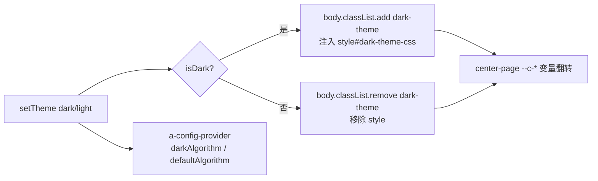
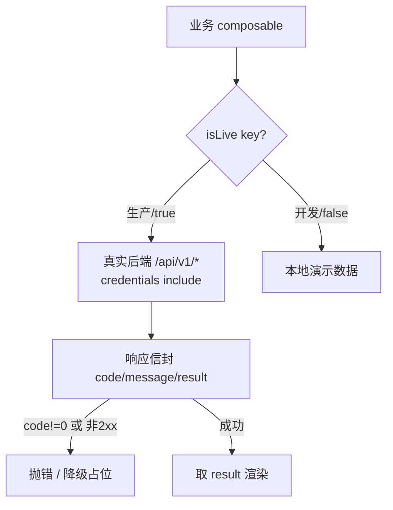

# 工业图像智能检测智能体 · 前端设计开发标准

> 交付对象：协同开发商
> 适用范围：`frontend/`（Vue 版前端）
> 基线来源：当前代码实测（非规划稿）。改完必须 `npm run build` 通过再交付。

---

## 0. 一句话定位

纯前端 SPA，对接 `quality-agent`（FastAPI）后端；**双主题（银白 / 深蓝）+ 全链路可降级（真实后端 ↔ 本地演示）**；六领域能力注册表驱动。

---

## 1. 技术栈（锁定，勿随意升级）

| 项 | 版本 | 说明 |
|---|---|---|
| Vue | ^3.4 | 组合式 API，`<script setup lang="ts">` |
| TypeScript | ^5.4 | 严格模式 |
| Vite | ^4.5 | 构建 / dev |
| Ant Design Vue | ^4.2 | 全局 `app.use(Antd)`，组件 + 自定义 CSS 融合 |
| vue-router | ^4.3 | `createWebHistory` |
| Node | ≥16.14（实测 16.20.2） | |
| 状态管理 | 无 Pinia | 全局状态用**模块级 `ref` 单例**（composable 内定义在函数外） |

脚本：`npm run dev` / `npm run build` / `npm run preview`。

---

## 2. 目录结构（约定即规范）

```
src/
  api/          每个后端域一个文件（agent.ts / ragflow.ts / config-resources.ts …）
                + source-registry.ts（数据源总闸，见 §6）
  components/   通用件（AppHeader / IconSvg / MarkdownView / ImageLightbox …）
  composables/  use-xxx.ts（状态逻辑，模块级单例 ref）
  data/         静态数据与契约（icon-paths.ts / capability-presets.ts / types.ts）
  views/        页面；复杂模块建子目录（task/ knowledge/ tools/ admin/）
  styles/       全局 CSS，按模块分文件（见 §4 导入顺序）
  router/       index.ts（路由 + 守卫 + 标题）
```

- 路径别名 `@` → `src`（vite.config 已配）。
- 组件目录放置：跨页复用进 `components/`，模块私有件放该 view 子目录内。

---

## 3. 主题与视觉体系（核心）

- **变量驱动**：`center-page` 系列 CSS 变量 `--c-bg / --c-panel / --c-ink / --c-muted / --c-line / --c-blue / --c-tint / --c-shadow / --c-soft` 是唯一取色来源，**禁止硬编码颜色**（特殊强调色除外）。
- **页面挂类**：`App.vue` 按路由给 `<body>` 切类：`center-page`（能力 / 检测 / 任务 / 知识 / 工具 / 报告 / 后台共用变量体系）+ 各自 `detection-page / task-page / knowledge-page / report-page`。新页面若复用该体系，务必在此登记。
- **暗色机制**：银白为默认；深蓝通过 `use-theme.ts` 的 `setTheme('dark')` 注入一个**可移除的 `<style>`**（`dark.css?inline`）并加 `body.dark-theme` 类。切回亮色即卸载 style，彻底还原。
  - ⚠️ 深色样式必须走这套注入，**不要在组件里 `import` 深色 CSS**（Vite 动态 import 的 CSS 无法卸载，会导致主题切不回去）。
- AntD 主题联动：`App.vue` 用 `a-config-provider` 按 `theme` 切 `darkAlgorithm / defaultAlgorithm`。



---

## 4. CSS 分层与 AntD 融合

- **导入顺序固定**（`main.ts`，后者覆盖前者）：

  ```
  reset.css → style.css → navigation.css → center.css → detection.css
  → task.css → knowledge.css → tools.css → report.css → login.css
  → antd-overrides.css
  ```

  `antd-overrides.css` **永远最后**，专用于修正 AntD 组件与自定义视觉的冲突。

- **特异性陷阱（血泪规范）**：
  - 全局元素选择器经 `:where()` 特异性过低会被 AntD 组件样式盖过——**不要靠抬高特异性硬压**，优先用 `antd-overrides.css` 精准选择器。
  - 容器后代 `span` 规则易误伤 AntD 按钮内部 `<span>`，选择器要限定作用域。
  - 全局 `focus-visible` 轮廓会覆盖组件的 `outline:none`。
- **角色类加 `is-` 前缀**：消息气泡等用 `.det-msg.is-assistant / .is-user`，避免与全局 `.assistant` 等类名冲突污染布局（知识页、检测页均因此踩过坑）。
- 流式渲染组件（光标 / 错误横幅 / 思考折叠 / 工具行 / 任务卡片）一律基于 `--c-*` 变量，自动适配双主题。

---

## 5. 图标系统

- **统一线性图标**：`data/icon-paths.ts`，全部 **24×24 viewBox** 的 SVG path，经 `components/IconSvg.vue` 渲染，`<IconSvg name="spark" />`。
- **全局规格**：默认 `20px / stroke-width 1.7`（style.css 全局 svg 规则）。
- **菜单 / 密集场景**：固定 `17px / stroke 1.8`，用 flex 对齐（见 §9 Composer）。
- 新增图标：在 `icon-paths.ts` 的 `IconName` 联合类型 + `iconPaths` 里补一条，**不要在组件里散落内联 SVG**（Composer 的 +/chevron/send 等无对应图标时才内联）。
- 混合渲染：业务图片资产（能力卡图 `public/assets/cap-*.png`）与线性图标共存，各用其位。

---

## 6. API 层规范（重点：可降级）

- **总闸 + 逐接口开关**：`api/source-registry.ts`
  - 生产 `VITE_QA_ENABLED=true`：所有接口恒走真实后端。
  - 开发 `=false`：每个「接口单元」可在 `/admin` 接口监控页切 mock / 真实，选择存 `localStorage`。
  - 业务 composable 用 `isLive(key)` 响应式决定走真实还是本地演示。
  - **新增真实化端点 → 在 `DEFS` 登记**（key/label/group/method/path/probePath），即纳入探活与监控。
- **统一响应信封**：`{ code, message, result }`；`code!==0` 或 HTTP 非 2xx 抛错；成功取 `result`。各 api 文件用私有 `xxxFetch` 封装（见 `agent.ts` 的 `qaFetch`）。
- **鉴权**：前端**只持有 httpOnly 会话 Cookie**，`fetch` 一律 `credentials:'include'`；**不注入 Authorization**，RAGFlow / MinIO 密钥不下发前端。401 → 提示「未登录或会话已失效」。
- **同源代理**：浏览器请求 `/api/*`，Vite `server.proxy` 按 `QUALITY_AGENT_BASE_URL`（默认 `http://localhost:8000`）转发；生产由 Nginx 反代。
- **SSE 流式协议**（`agent.ts` `streamMessages`）：`GET /agent/sessions/{id}/stream`，按帧顶层 `type` 分派四类；首帧全量历史回放，心跳 `: ping` 忽略；返回 `close()` 用于切会话 / 卸载中止。



**SSE 四类帧（顶层 `type` 分派）**

| 帧类型 | 语义 | 前端渲染 |
|---|---|---|
| `message` | 正文逐字 start/delta/end | 打字机光标，`end` 收尾 |
| `thinking` | 思维链 start/delta/end | 折叠行 |
| `chain` | 工具调用 tool_call / tool_result | 原地更新的调用行（done/is_error） |
| `card` | 任务 / 复核 / 完成 / 报告生命周期 | 左边框色编码卡片 |
| `error` | 流内错误 | 错误横幅 |

---

## 7. 路由与鉴权守卫

- 路由：`/`、`/capabilities`、`/detection`、`/tasks`、`/report/:taskId`、`/knowledge`、`/tools`、`/admin`(+`/llm|/ragflow|/storage`)、`/login`；404 回 `/`。
- 全局守卫：**仅远程模式强制登录**（`ragflowEnabled=false` 演示模式直接放行）；未登录跳 `/login` 带 `redirect`。
- `afterEach` 统一维护 `document.title`；`?theme=dark` 控制首页深蓝。

---

## 8. 内容渲染安全

- Markdown 用自研 **`MarkdownView`**（零依赖、防 XSS），**不引入第三方 markdown 库**；图片点开走通用 `ImageLightbox`。

---

## 9. 对话框（Composer）统一设计标准 ★

所有对话输入框（首页 + 智能检测开始态 / 会话态）**必须同一套**，参照 WorkBuddy / 通义千问：

- **容器**：圆角卡片 + 柔和渐变背景 + `focus-within` 光环；占位「今天帮你做些什么？…」。
- **左下**：「＋」按钮下拉 → `添加文件` + `选择技能 / 检测方向`（能力列表，当前项带对勾）。
- **右下**：模型切换胶囊（`listResources('llm')` 拉供应商，含「自动 · 智能路由」）+ 字数计数（0/3000）+ 圆形渐变发送按钮（向上箭头，hover 抬升）。
- **附件 / 技能**：以圆角 Chip 行呈现，可一键移除。
- **菜单图标对齐**：AntD 下拉**用 `a-menu-item-group` 扁平化，勿用嵌套 `a-sub-menu`**（子菜单弹层 teleport 会脱离样式作用域导致图标参差）；下拉加 `overlay-class-name="assistant-menu"`，在 `antd-overrides.css` 里全局统一：`svg 17px / stroke 1.8`、`display:flex; align-items:center; gap:10px`、选中对勾 `.assistant-menu-check`。
- 首页全局类（`composer-toolbar / tool-plus / tool-model / send-round / char-count / cchip`）被检测页复用，勿各写一套。
- ⚠️ 现状：模型切换目前**仅 UI / 路由层**，后端 `sendMessage` 未接收 `model` 参数（运行时用配置默认基模）。要真正生效需给 `sendRequest/sendMessage` 加 `model` 透传。

---

## 10. 能力与数据契约

- 六领域：`fpi 荧光渗透 / borescope 孔探 / infrared 热部图像 / dr X射线 / fracture 断口 / metallography 金相`。
- **展示短名**取 `data/capability-presets.ts`（按 `scene` 索引）；后端注册表 `merge` 时 `name = cap.name || preset.name`——**后端脏标题（含「（Mock…）」括号备注）不覆盖前端短名**，卡片标题统一用短名。
- 能力卡无值字段（如 `endpoint`）用 `v-if` 隐藏，不占位。
- **Mock → 真实替换**：Mock 服务对接后替换 endpoint 即完成真实化，验收以「载荷指纹」判定（健康检查返回 200 ≠ 真实模型）。

---

## 11. 工程与协同约定

- **行为等价重构**：重构不得改变可观察行为；改动尽量小、贴合周边代码风格与注释密度。
- **全链路可降级**：任一后端不可达须优雅回退本地演示 / 占位，不阻断页面。
- 新增接口 → 先登记 `source-registry.DEFS`；新增能力 → 补 `capability-presets` + 后端注册；新增图标 → 补 `icon-paths`。
- 命名：composable `use-xxx`、api 按域、CSS 类模块前缀（`det-` / `cap-` / `assistant-` 等）。

---

## 12. 环境配置（`.env.local`，参考 `.env.example`）

```
VITE_QA_ENABLED=true          # 真实后端总闸（false=纯演示）
VITE_QA_API_BASE=/api/v1      # 前端 API 前缀
QUALITY_AGENT_BASE_URL=http://localhost:8000  # 仅代理用，不打包进前端
```

RAGFlow / MinIO 的 base_url / key / chat_id / dataset_id **全部由后端管理，前端不配置**。

---

## 13. 交付验收 Checklist

### 13.1 每次改动通用
- [ ] `npm run build` 通过（无 TS / 打包错误）
- [ ] 银白 + 深蓝两主题手测无异常
- [ ] 演示模式（`VITE_QA_ENABLED=false`）无 console error
- [ ] 未新增硬编码颜色（走 `--c-*` 变量）
- [ ] 未破坏既有可观察行为（行为等价）

### 13.2 新增 / 改造接口
- [ ] 在 `api/source-registry.ts` 的 `DEFS` 登记单元
- [ ] 走统一信封 `{code,message,result}`，异常抛错并降级
- [ ] `fetch` 带 `credentials:'include'`，不注入 Authorization
- [ ] 401 有「未登录」提示与跳转

### 13.3 新增能力 / 页面
- [ ] 补 `capability-presets.ts` 短名 + 后端注册
- [ ] 新页面在 `App.vue` 登记 `center-page` + 模块类名
- [ ] 路由 + `afterEach` 标题维护
- [ ] 对话框复用 §9 统一 Composer 标准

### 13.4 样式 / 组件
- [ ] 全局覆盖放 `antd-overrides.css`（最后导入）
- [ ] 角色类用 `is-` 前缀避免污染
- [ ] 深色样式走 `use-theme` 注入，不在组件内 import 深色 CSS
- [ ] 菜单用 `a-menu-item-group` 扁平化 + `assistant-menu` 对齐

### 13.5 图标
- [ ] 新图标进 `icon-paths.ts`（24×24），不散落内联 SVG
- [ ] 规格：默认 20px/1.7，菜单 17px/1.8

---

*本文件为规范基线，随代码演进更新；如与实现冲突，以最新代码 + 本 checklist 复核为准。*
